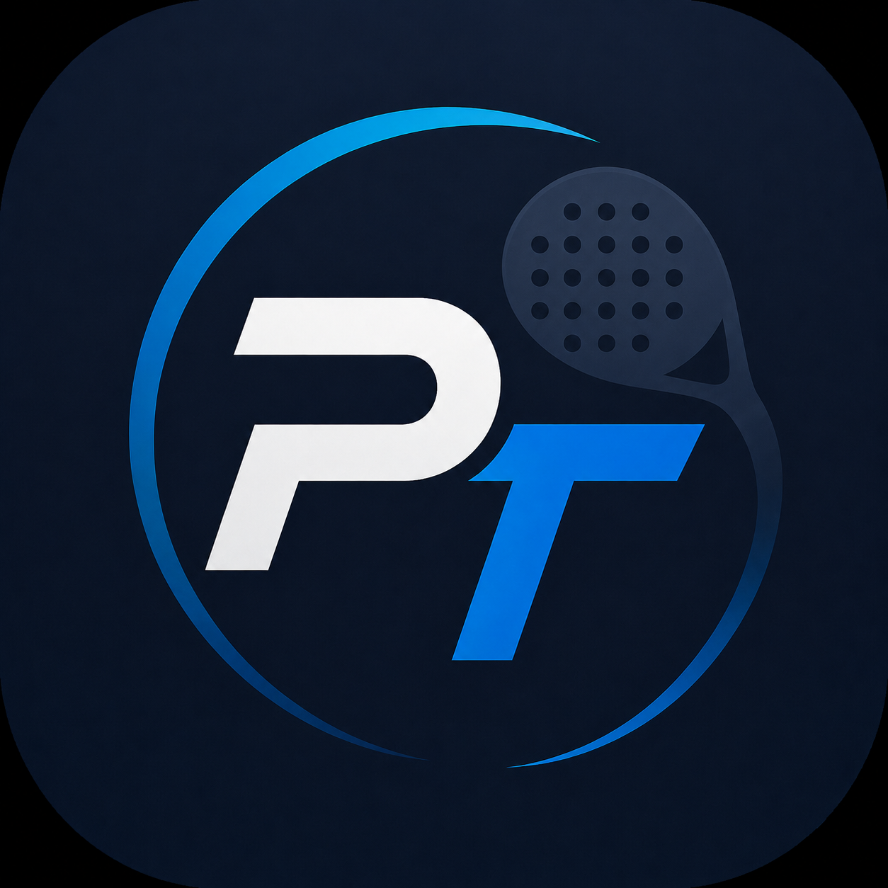
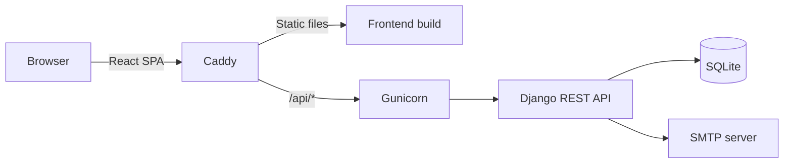
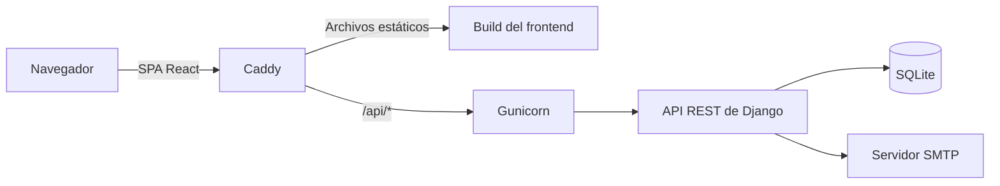

<div align="center">
  

  # PadelTrack

  **Matches, scoreboards, statistics, and clear accounts for padel groups.**

  [](https://react.dev/)
  [](https://vite.dev/)
  [](https://www.djangoproject.com/)
  [](https://www.django-rest-framework.org/)
  [](https://www.python.org/)

  [English](#english) · [Español](#espanol)
</div>

---

<a id="english"></a>

# English

## About PadelTrack

PadelTrack is a full-stack web application that brings the entire lifecycle of a padel match into one place. It helps groups organize sessions, manage attendance, record results, track player statistics, split court costs, and settle outstanding balances.

Players can also create or join public sessions available in their Spanish province, making it easier to find a match outside their usual groups.

The application interface and transactional emails are currently available in Spanish.

## Features

### Groups and sessions

- Create private groups and manage their members.
- Assign group administrators with additional management permissions.
- Schedule private sessions with a date, venue, optional Google Maps link, and total court cost.
- Confirm, decline, and manage player attendance.
- Notify verified group members by email when a new private session is created.
- Browse past and upcoming sessions from the group history.

### Public matches

- Publish sessions for players in the same Spanish province.
- Define the venue, date, description, cost, and maximum number of players.
- Join available sessions while places remain.
- Manage the full session lifecycle as its creator.

### Scoring and statistics

- Record a classic match when exactly four players take part.
- Run a King of the Court session when more than four players participate.
- Generate teams and track points, winning streaks, and crowns.
- Review session results and group rankings.
- See personal activity totals from the user profile.

### Costs and settlements

- Select the player who paid for the court.
- Split the session cost equally among confirmed players.
- Calculate each member's overall group balance.
- Generate suggested transfers between debtors and creditors.
- Record completed settlements and keep a payment history.

> PadelTrack records settlements between players, but it does not connect to Bizum or any other payment provider.

### Accounts and experience

- Register with a unique email address and Spanish province.
- Verify accounts by email before signing in.
- Authenticate through JSON Web Tokens.
- Recover forgotten passwords by email.
- Update the profile and password.
- Switch between light and dark themes.
- Use the responsive interface on desktop and mobile devices.

## How It Works

1. Create an account and verify your email address.
2. Create a private group or browse public sessions in your province.
3. Schedule a match and let players confirm their attendance.
4. Start the session with at least four confirmed players.
5. Record a classic result or play in King of the Court mode.
6. Finalize the session, select the court payer, and review the resulting balances.

## Tech Stack

| Area | Technologies |
| --- | --- |
| Frontend | React 19, React Router, Vite 8, Axios, Bootstrap 5 |
| Backend | Python 3.12, Django 6, Django REST Framework |
| Authentication | Simple JWT, Django email verification and password-reset tokens |
| Database | SQLite |
| Production server | Gunicorn, Caddy |
| Infrastructure | Docker, Docker Compose, GitHub Actions |

## Architecture



The React single-page application communicates with Django exclusively through JSON endpoints under `/api/`. In production, Caddy serves the compiled frontend and forwards API requests to Gunicorn. Django owns authentication, permissions, validation, session state, rankings, and accounting calculations.

## Repository Structure

```text
padeltrack/
├── backend/
│   ├── api/                 # Models, serializers, views, routes, and migrations
│   ├── core/                # Django project settings and entry points
│   ├── data/                # Persistent SQLite directory for Docker
│   ├── Dockerfile
│   ├── entrypoint.sh
│   └── manage.py
├── frontend/
│   ├── public/              # Public images and icons
│   ├── src/
│   │   ├── components/      # Reusable UI and domain components
│   │   ├── constants/       # Spanish province data
│   │   ├── pages/           # Route-level screens
│   │   └── services/        # API and authentication clients
│   ├── package.json
│   └── vite.config.js
├── .github/workflows/       # Continuous deployment workflow
├── Caddyfile                # HTTPS, static files, and API reverse proxy
├── docker-compose.yml
└── requirements.txt
```

## Getting Started

### Prerequisites

- Python 3.12
- Node.js `^20.19.0` or `>=22.12.0`
- npm
- Git

Docker and Docker Compose are only required for the containerized production setup.

### 1. Clone the repository

```bash
git clone https://github.com/mserrador/padeltrack.git
cd padeltrack
```

### 2. Start the backend

From the repository root:

```bash
python3.12 -m venv venv
source venv/bin/activate
python -m pip install --upgrade pip
python -m pip install -r requirements.txt
cd backend
python manage.py migrate
python manage.py runserver
```

The API will be available at `http://127.0.0.1:8000/api/`.

The default development configuration writes outgoing emails to the backend terminal. Registration, verification, and password-reset links can therefore be tested without configuring an SMTP server.

Optional: create an administrator account with:

```bash
python manage.py createsuperuser
```

### 3. Start the frontend

In a second terminal:

```bash
cd frontend
npm ci
npm run dev
```

Open `http://localhost:5173`. During development, the frontend connects to `http://127.0.0.1:8000/api/` by default.

## Configuration

Django reads its configuration from environment variables. Local development works with the built-in development defaults, but production deployments must provide secure values.

| Variable | Purpose | Development default |
| --- | --- | --- |
| `DJANGO_SECRET_KEY` | Django cryptographic secret | Insecure development value |
| `DEBUG` | Enables Django debug mode | `true` |
| `ALLOWED_HOSTS` | Comma-separated accepted hosts | `localhost,127.0.0.1` |
| `CORS_ALLOW_ALL_ORIGINS` | Allows every CORS origin | `false` |
| `CORS_ALLOWED_ORIGINS` | Comma-separated frontend origins | Local Vite origins |
| `SQLITE_PATH` | SQLite database file path | `backend/db.sqlite3` |
| `FRONTEND_URL` | Base URL used in emailed links | `http://localhost:5173` |
| `EMAIL_BACKEND` | Django email backend | SMTP if a host exists, console otherwise |
| `EMAIL_HOST` | SMTP hostname | Empty |
| `EMAIL_PORT` | SMTP port | `587` |
| `EMAIL_HOST_USER` | SMTP username | Empty |
| `EMAIL_HOST_PASSWORD` | SMTP password | Empty |
| `EMAIL_USE_TLS` | Enables SMTP TLS | `true` |
| `EMAIL_USE_SSL` | Enables SMTP SSL | `false` |
| `DEFAULT_FROM_EMAIL` | Sender shown in application emails | Local PadelTrack address |
| `VITE_API_BASE_URL` | Frontend API base URL at build time | Development API or `/api/` |
| `APP_DOMAIN` | Domain supplied to the Caddy container | `localhost` |

Never commit production credentials or secret keys to version control.

## Available Commands

### Backend

Run from `backend/` with the virtual environment active:

```bash
python manage.py runserver                    # Start the development API
python manage.py migrate                      # Apply database migrations
python manage.py makemigrations --check --dry-run  # Check for migration drift
python manage.py check                        # Run Django system checks
python manage.py test                         # Run Django tests
```

### Frontend

Run from `frontend/`:

```bash
npm run dev       # Start the Vite development server
npm run build     # Create the production build
npm run lint      # Run ESLint
npm run preview   # Preview the production build locally
```

## API Overview

All API routes are prefixed with `/api/`.

| Area | Main endpoints |
| --- | --- |
| Authentication | `registro/`, `token/`, `token/refresh/` |
| Account recovery | `verificar-email/`, `reenviar-verificacion/`, `solicitar-restablecer-password/`, `restablecer-password/` |
| Users | `usuarios/`, `usuarios/me/`, `usuarios/cambiar-password/` |
| Groups | `grupos/`, `grupos/{id}/miembros/`, `grupos/{id}/estadisticas/` |
| Sessions | `sesiones/`, `asistencias/`, `sesiones-publicas/`, `asistencias-sesiones-publicas/` |
| Results | `partidos-clasicos/`, `mini-partidos/` |
| Accounting | `pagos/`, `liquidaciones/`, `grupos/{id}/balance/` |

Protected requests use the header `Authorization: Bearer <access-token>`. The backend remains authoritative for permissions, membership, capacity, valid state transitions, and financial calculations.

## Database

PadelTrack currently uses SQLite and Django migrations. No seed data or fixtures are required.

For Docker persistence, `SQLITE_PATH` must point to a file inside `/app/backend/data`, which is the directory mounted by Docker Compose.

## Deployment

The repository contains a VPS-oriented deployment setup:

- The frontend is compiled with Vite.
- Caddy serves `frontend/dist`, applies compression and manages HTTPS.
- Requests under `/api/*` are forwarded to the backend container.
- Gunicorn runs the Django application with three workers.
- The backend entrypoint applies migrations and collects static files before startup.
- GitHub Actions validates Django, builds the frontend, uploads the application, and recreates the Docker Compose stack on pushes to `main`.

The current `Caddyfile` contains a deployment-specific hostname. Update it before deploying the stack under a different domain.

## Project Status

The main product workflows are implemented and deployed through continuous delivery. Automated test coverage is not yet established: the backend test module is currently a placeholder and the frontend has no test runner configured. The available quality checks are Django's system check, frontend linting, and the production build.

## License

No license has been added to this repository. Unless a license is provided, the source code remains under the copyright holder's default rights and no reuse permission is granted.

---

<a id="espanol"></a>

# Español

## Sobre PadelTrack

PadelTrack es una aplicación web full stack que reúne en un único lugar todo el ciclo de un partido de pádel. Permite a los grupos organizar sesiones, gestionar la asistencia, registrar resultados, consultar estadísticas, repartir el coste de la pista y liquidar los saldos pendientes.

Los jugadores también pueden crear o unirse a sesiones públicas disponibles en su provincia, facilitando encontrar partido fuera de sus grupos habituales.

La interfaz de la aplicación y los correos transaccionales están disponibles actualmente en español.

## Funcionalidades

### Grupos y sesiones

- Creación de grupos privados y gestión de sus miembros.
- Asignación de administradores con permisos adicionales.
- Programación de sesiones privadas con fecha, lugar, enlace opcional de Google Maps y coste total.
- Confirmación, rechazo y gestión de la asistencia de los jugadores.
- Avisos por correo a los miembros verificados cuando se crea una sesión privada.
- Consulta de sesiones anteriores y próximas desde el historial del grupo.

### Partidos públicos

- Publicación de sesiones para jugadores de la misma provincia española.
- Definición del lugar, fecha, descripción, coste y número máximo de jugadores.
- Inscripción en sesiones mientras queden plazas disponibles.
- Gestión del ciclo completo de la sesión por parte de su creador.

### Marcadores y estadísticas

- Registro de un partido clásico cuando participan exactamente cuatro jugadores.
- Modo Rey de la Pista para sesiones con más de cuatro jugadores.
- Generación de equipos y seguimiento de puntos, rachas y coronas.
- Consulta de resultados y clasificaciones del grupo.
- Resumen de actividad personal desde el perfil de usuario.

### Costes y liquidaciones

- Selección del jugador que ha pagado la pista.
- Reparto equitativo del coste entre los jugadores confirmados.
- Cálculo del balance global de cada miembro del grupo.
- Generación de transferencias sugeridas entre deudores y acreedores.
- Registro de liquidaciones completadas e historial de pagos.

> PadelTrack registra liquidaciones entre jugadores, pero no se conecta con Bizum ni con ningún otro proveedor de pagos.

### Cuentas y experiencia de uso

- Registro con correo electrónico único y provincia española.
- Verificación de la cuenta por correo antes de iniciar sesión.
- Autenticación mediante JSON Web Tokens.
- Recuperación de contraseñas olvidadas por correo.
- Actualización del perfil y de la contraseña.
- Temas claro y oscuro.
- Interfaz responsive para ordenadores y dispositivos móviles.

## Cómo Funciona

1. Crea una cuenta y verifica tu dirección de correo.
2. Crea un grupo privado o busca sesiones públicas en tu provincia.
3. Programa un partido y deja que los jugadores confirmen su asistencia.
4. Inicia la sesión cuando haya al menos cuatro jugadores confirmados.
5. Registra un resultado clásico o juega en modo Rey de la Pista.
6. Finaliza la sesión, selecciona quién pagó la pista y consulta los balances resultantes.

## Tecnologías

| Área | Tecnologías |
| --- | --- |
| Frontend | React 19, React Router, Vite 8, Axios, Bootstrap 5 |
| Backend | Python 3.12, Django 6, Django REST Framework |
| Autenticación | Simple JWT, verificación de correo y tokens de recuperación de Django |
| Base de datos | SQLite |
| Servidor de producción | Gunicorn, Caddy |
| Infraestructura | Docker, Docker Compose, GitHub Actions |

## Arquitectura



La aplicación de página única desarrollada con React se comunica con Django exclusivamente mediante endpoints JSON bajo `/api/`. En producción, Caddy sirve el frontend compilado y reenvía las peticiones de la API a Gunicorn. Django controla la autenticación, los permisos, la validación, los estados de las sesiones, las clasificaciones y los cálculos económicos.

## Estructura del Repositorio

```text
padeltrack/
├── backend/
│   ├── api/                 # Modelos, serializadores, vistas, rutas y migraciones
│   ├── core/                # Configuración y puntos de entrada de Django
│   ├── data/                # Directorio SQLite persistente para Docker
│   ├── Dockerfile
│   ├── entrypoint.sh
│   └── manage.py
├── frontend/
│   ├── public/              # Imágenes e iconos públicos
│   ├── src/
│   │   ├── components/      # Componentes reutilizables y de dominio
│   │   ├── constants/       # Datos de provincias españolas
│   │   ├── pages/           # Pantallas asociadas a rutas
│   │   └── services/        # Clientes de API y autenticación
│   ├── package.json
│   └── vite.config.js
├── .github/workflows/       # Flujo de despliegue continuo
├── Caddyfile                # HTTPS, archivos estáticos y proxy inverso de la API
├── docker-compose.yml
└── requirements.txt
```

## Puesta en Marcha

### Requisitos previos

- Python 3.12
- Node.js `^20.19.0` o `>=22.12.0`
- npm
- Git

Docker y Docker Compose solo son necesarios para el despliegue en contenedores.

### 1. Clonar el repositorio

```bash
git clone https://github.com/mserrador/padeltrack.git
cd padeltrack
```

### 2. Iniciar el backend

Desde la raíz del repositorio:

```bash
python3.12 -m venv venv
source venv/bin/activate
python -m pip install --upgrade pip
python -m pip install -r requirements.txt
cd backend
python manage.py migrate
python manage.py runserver
```

La API estará disponible en `http://127.0.0.1:8000/api/`.

La configuración de desarrollo predeterminada escribe los correos salientes en la terminal del backend. De esta forma se pueden probar el registro, la verificación y la recuperación de contraseña sin configurar un servidor SMTP.

Opcionalmente, puedes crear una cuenta de administración con:

```bash
python manage.py createsuperuser
```

### 3. Iniciar el frontend

En una segunda terminal:

```bash
cd frontend
npm ci
npm run dev
```

Abre `http://localhost:5173`. Durante el desarrollo, el frontend se conecta por defecto a `http://127.0.0.1:8000/api/`.

## Configuración

Django obtiene su configuración de variables de entorno. El desarrollo local funciona con los valores predeterminados incluidos, pero los despliegues de producción deben proporcionar valores seguros.

| Variable | Finalidad | Valor de desarrollo |
| --- | --- | --- |
| `DJANGO_SECRET_KEY` | Secreto criptográfico de Django | Valor de desarrollo inseguro |
| `DEBUG` | Activa el modo de depuración de Django | `true` |
| `ALLOWED_HOSTS` | Hosts aceptados separados por comas | `localhost,127.0.0.1` |
| `CORS_ALLOW_ALL_ORIGINS` | Permite cualquier origen CORS | `false` |
| `CORS_ALLOWED_ORIGINS` | Orígenes del frontend separados por comas | Orígenes locales de Vite |
| `SQLITE_PATH` | Ruta del archivo SQLite | `backend/db.sqlite3` |
| `FRONTEND_URL` | URL base utilizada en enlaces enviados por correo | `http://localhost:5173` |
| `EMAIL_BACKEND` | Backend de correo de Django | SMTP si existe un host, consola en caso contrario |
| `EMAIL_HOST` | Servidor SMTP | Vacío |
| `EMAIL_PORT` | Puerto SMTP | `587` |
| `EMAIL_HOST_USER` | Usuario SMTP | Vacío |
| `EMAIL_HOST_PASSWORD` | Contraseña SMTP | Vacío |
| `EMAIL_USE_TLS` | Activa TLS para SMTP | `true` |
| `EMAIL_USE_SSL` | Activa SSL para SMTP | `false` |
| `DEFAULT_FROM_EMAIL` | Remitente mostrado en los correos | Dirección local de PadelTrack |
| `VITE_API_BASE_URL` | URL base de la API durante el build | API de desarrollo o `/api/` |
| `APP_DOMAIN` | Dominio proporcionado al contenedor de Caddy | `localhost` |

No guardes credenciales de producción ni claves secretas en el control de versiones.

## Comandos Disponibles

### Backend

Ejecuta estos comandos desde `backend/` con el entorno virtual activo:

```bash
python manage.py runserver                    # Inicia la API de desarrollo
python manage.py migrate                      # Aplica las migraciones
python manage.py makemigrations --check --dry-run  # Detecta migraciones pendientes
python manage.py check                        # Ejecuta las comprobaciones de Django
python manage.py test                         # Ejecuta las pruebas de Django
```

### Frontend

Ejecuta estos comandos desde `frontend/`:

```bash
npm run dev       # Inicia el servidor de desarrollo de Vite
npm run build     # Genera el build de producción
npm run lint      # Ejecuta ESLint
npm run preview   # Previsualiza el build de producción
```

## Resumen de la API

Todas las rutas de la API utilizan el prefijo `/api/`.

| Área | Endpoints principales |
| --- | --- |
| Autenticación | `registro/`, `token/`, `token/refresh/` |
| Recuperación de cuenta | `verificar-email/`, `reenviar-verificacion/`, `solicitar-restablecer-password/`, `restablecer-password/` |
| Usuarios | `usuarios/`, `usuarios/me/`, `usuarios/cambiar-password/` |
| Grupos | `grupos/`, `grupos/{id}/miembros/`, `grupos/{id}/estadisticas/` |
| Sesiones | `sesiones/`, `asistencias/`, `sesiones-publicas/`, `asistencias-sesiones-publicas/` |
| Resultados | `partidos-clasicos/`, `mini-partidos/` |
| Contabilidad | `pagos/`, `liquidaciones/`, `grupos/{id}/balance/` |

Las peticiones protegidas utilizan la cabecera `Authorization: Bearer <access-token>`. El backend mantiene la autoridad sobre permisos, pertenencia a grupos, aforo, transiciones de estado válidas y cálculos económicos.

## Base de Datos

PadelTrack utiliza actualmente SQLite y migraciones de Django. No se necesitan datos iniciales ni fixtures.

Para mantener los datos al usar Docker, `SQLITE_PATH` debe apuntar a un archivo dentro de `/app/backend/data`, que es el directorio montado por Docker Compose.

## Despliegue

El repositorio contiene una configuración de despliegue orientada a una VPS:

- El frontend se compila con Vite.
- Caddy sirve `frontend/dist`, aplica compresión y gestiona HTTPS.
- Las peticiones bajo `/api/*` se reenvían al contenedor del backend.
- Gunicorn ejecuta Django con tres workers.
- El entrypoint del backend aplica las migraciones y recopila los archivos estáticos antes de arrancar.
- GitHub Actions valida Django, compila el frontend, sube la aplicación y recrea los servicios de Docker Compose con cada push a `main`.

El `Caddyfile` actual contiene un hostname específico del despliegue. Debes actualizarlo antes de desplegar el stack bajo otro dominio.

## Estado del Proyecto

Los flujos principales del producto están implementados y se despliegan mediante entrega continua. Todavía no existe una cobertura real de pruebas automatizadas: el módulo de pruebas del backend es actualmente una plantilla y el frontend no tiene configurado un test runner. Las comprobaciones disponibles son el chequeo de Django, el lint del frontend y el build de producción.

## Licencia

Este repositorio no incluye actualmente una licencia. Mientras no se añada una, el código fuente conserva los derechos predeterminados de su titular y no se concede permiso de reutilización.
